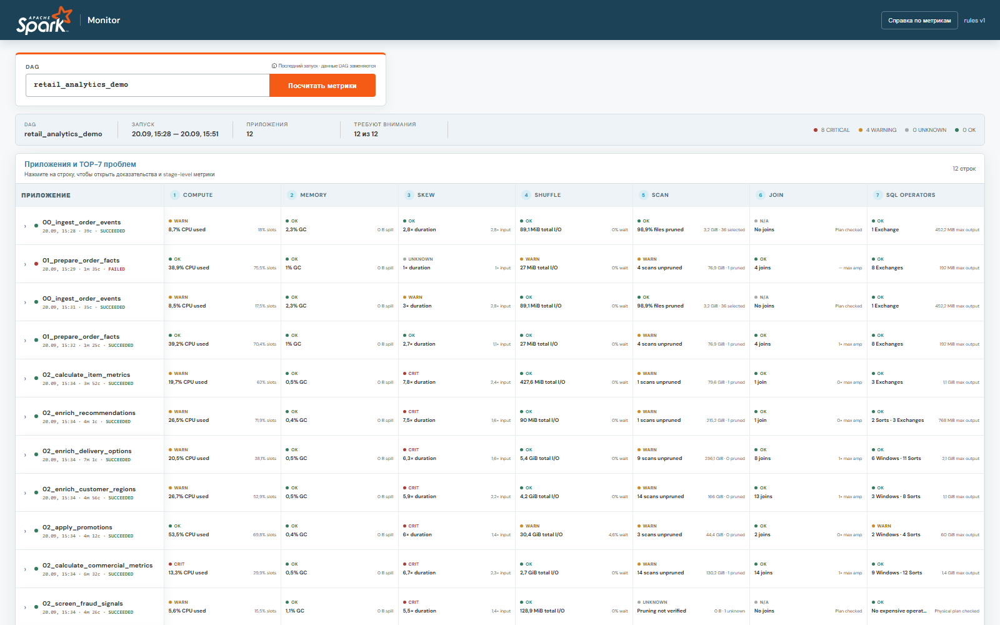

# Spark Event Monitor

Локальный анализатор Spark Event Log с веб-интерфейсом. Он разбирает логи Spark-приложений, рассчитывает метрики производительности и показывает проблемы с compute, memory, skew, shuffle, scan, join и SQL-планами.

Репозиторий содержит небольшую синтетическую демо-выборку. Она предназначена только для знакомства с интерфейсом и не содержит исходных Event Log, учётных данных или адресов рабочей инфраструктуры.



## Возможности

- потоковый разбор обычных и сжатых Spark Event Log;
- поддержка JSON, ZIP, gzip, bzip2, xz и каталогов rolling logs;
- нормализация applications, executors, jobs, stages, tasks и SQL executions;
- анализ AQE и финального физического SQL-плана;
- диагностика загрузки CPU, памяти, skew, shuffle, scan, join и SQL operators;
- версионируемые правила и пороговые значения;
- сохранение отчётов в JSON и, опционально, SQLite;
- локальный dashboard без внешней базы данных и frontend-сборщика;
- загрузка последнего запуска DAG из Spark History Server.

## Стек

- Python 3.11+;
- стандартная библиотека Python: `argparse`, `http.server`, `json`, `sqlite3`, `urllib`;
- vanilla HTML, CSS и JavaScript;
- Apache Spark Event Log и REST API Spark History Server;
- опциональные `lz4`, `zstandard` и `python-snappy` для дополнительных форматов сжатия.

В основном режиме у проекта нет обязательных сторонних runtime-зависимостей.

## Быстрый запуск демо

Клонируйте репозиторий и перейдите в его каталог:

```powershell
git clone <URL-ВАШЕГО-РЕПОЗИТОРИЯ>
cd spark-app-monitoring
```

При желании создайте виртуальное окружение и установите проект:

```powershell
python -m venv .venv
.\.venv\Scripts\Activate.ps1
python -m pip install -e .
```

Запустите dashboard с подготовленными демо-отчётами:

```powershell
python -m spark_monitor serve --reports-dir demo\reports --host 127.0.0.1 --port 8765
```

Откройте <http://127.0.0.1:8765>. Для остановки сервера нажмите `Ctrl+C`.

Если порт `8765` занят, укажите другой, например `--port 8766`, и откройте соответствующий адрес.

Для простого просмотра демо не нажимайте «Посчитать метрики»: эта операция предназначена для подключения к настоящему Spark History Server.

## Анализ собственного Event Log

```powershell
python -m spark_monitor parse <путь-к-event-log-или-zip>
```

По умолчанию JSON-отчёт будет записан в `data/reports/<application-id>.json`. Можно явно указать выходной файл и SQLite-базу:

```powershell
python -m spark_monitor parse .\data\raw\spark-event-log.zip `
  --output .\data\reports\report.json `
  --db .\spark_monitor.db
```

Для LZ4, Zstandard и Snappy установите дополнительные codecs:

```powershell
python -m pip install -e ".[compression]"
```

После формирования отчётов запустите локальный интерфейс:

```powershell
python -m spark_monitor serve --reports-dir data\reports
```

## Подключение к Spark History Server

Кнопка «Посчитать метрики» ищет приложения с именами `<dag_name>__<task_name>`, скачивает их Event Log и собирает отчёт по последнему запуску DAG.

Адрес и, при необходимости, Basic Auth задаются через переменные окружения:

```powershell
$env:SPARK_HISTORY_URL = "https://spark-history.example.org"
$env:SPARK_HISTORY_USER = "username"
$env:SPARK_HISTORY_PASSWORD = "password"
python -m spark_monitor serve --reports-dir data\reports
```

Логин и пароль не записываются в отчёты. Spark properties с ключами, похожими на password, secret, token, credential или access key, заменяются на `[REDACTED]`.

## Структура проекта

```text
spark_monitor/         Python-пакет, HTTP API и web-интерфейс
spark_monitor/static/  HTML, CSS, JavaScript и изображения интерфейса
config/rules.v1.json   Версионируемые диагностические правила
demo/reports/          Обезличенная публичная демо-выборка
tests/                 Модульные тесты парсера и сервера
tools/                 Вспомогательные скрипты
```

Основные этапы обработки:

1. `reader.py` потоково читает Event Log и поддерживаемые архивы.
2. `normalizer.py` строит единую модель Spark Application.
3. `metrics.py` и `sql_analysis.py` рассчитывают фактические метрики и анализируют SQL/AQE.
4. `rules.py` применяет диагностические правила из `config/rules.v1.json`.
5. `report.py`, `storage.py` и `server.py` формируют JSON/SQLite и отдают локальный dashboard.

## Проверка

```powershell
python -m unittest discover -s tests -v
```

## Публичная демо-выборка

`demo/reports` содержит только санитизированные отчёты. Приватные IP, внутренние домены, S3-бакеты, Kubernetes service names, e-mail и имена таблиц заменены синтетическими значениями.

Если вы обновляете демо из собственных отчётов, сначала создайте публичную копию:

```powershell
python tools\build_public_demo.py --source data\reports --target demo\reports --limit 4
```

Не публикуйте `data/`, `spark_monitor.db`, исходные Event Log или файлы с переменными окружения. Они исключены через `.gitignore`.
